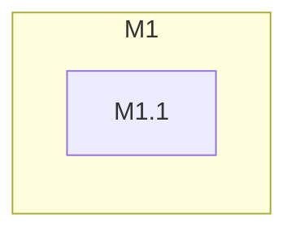

# <project name>: delivery

Status: draft

## Milestones

### M1: <name>

- Goal:
- Delivers (ids from `02-scope.md`):
- Definition of done:
- Status: not started

#### Deliverables

<!-- One row per pull request. Type is the Conventional Commits type and optional scope of its title. Delivers is `—` when it delivers no id. -->

| Id | Type | What it changes | Delivers |
| --- | --- | --- | --- |
| M1.1 | | | |

## Dependencies

<!--
One subgraph per milestone, one node per deliverable. `A --> B`: B can't start until A is merged.
Nodes with no incoming arrow are where implementation starts. Example:

flowchart LR
  subgraph M1
    M1_1["M1.1 build(scripts)"]
    M1_2["M1.2 feat(scoring)"]
    M1_3["M1.3 docs(runbook)"]
  end
  M1_1 --> M1_2 --> M1_3
-->

## Open questions

<!-- - Question — owner -->
